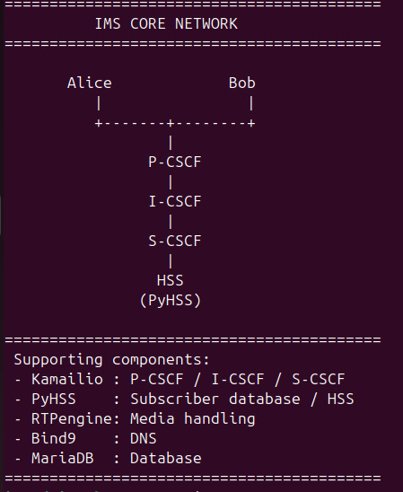
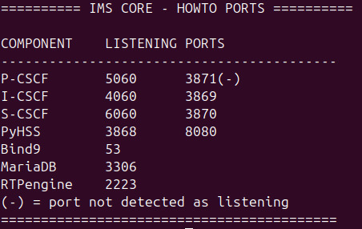
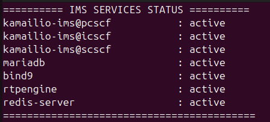
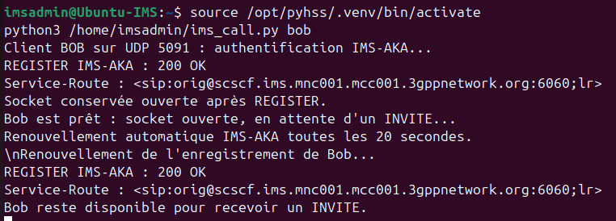
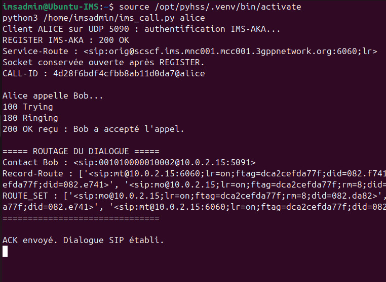

# Building an IMS Core Network from Scratch

### An Open-Source IMS Deployment on Ubuntu 24.04 — Without Docker

## About This Project

This repository documents my hands-on implementation of an IP Multimedia Subsystem (IMS) Core Network using open-source telecommunications technologies.

The project started with a practical objective: **build an IMS environment from scratch, understand how its different components communicate, and demonstrate the establishment of communication between IMS subscribers.**

Rather than deploying a ready-made containerized solution, I chose to install and configure the components directly on Ubuntu 24.04. This approach allowed me to work closer to the actual services, their configuration files, databases, signaling interfaces and interconnections.

This repository is both the result of that implementation and a technical record of the work carried out.

## 1. The IMS Environment

The deployed environment brings together the main functional entities of an IMS Core.

| Network element | Implementation | Purpose |
|---|---|---|
| P-CSCF | Kamailio | First point of contact for IMS clients |
| I-CSCF | Kamailio | Interrogates the HSS and selects an S-CSCF |
| S-CSCF | Kamailio | Handles subscriber registration and session control |
| HSS | PyHSS | Stores subscriber information and handles authentication-related operations |
| Media handling | RTPengine | Provides RTP media handling for SIP sessions |
| DNS | Bind9 | Resolves IMS network domains and hosts |
| Database | MariaDB | Stores IMS-related information |

**Main software environment:** Ubuntu 24.04 LTS  
**Kamailio version:** 6.1.5  
**Deployment approach:** Native installation, without Docker.

### IMS Core Architecture

The following diagram illustrates the architecture of the deployed IMS environment.



## 2. How the Components Work Together

The implementation focuses on the interaction between the IMS control functions and the subscriber database.

The three Kamailio instances have separate responsibilities:

- **P-CSCF:** receives SIP signaling from IMS clients.
- **I-CSCF:** communicates with the HSS to identify the appropriate serving CSCF.
- **S-CSCF:** provides the central session control functionality.

PyHSS provides the subscriber database and Diameter functionality required by the IMS environment.

Bind9 provides the domain name resolution used by the different IMS entities.

RTPengine is integrated into the Kamailio environment to handle media-related operations during calls.

## 3. Implementation Work

The work was carried out progressively, following an IMS deployment procedure and validating the different components along the way.

The main implementation activities included:

- Preparing the Ubuntu 24.04 environment.
- Building and installing Kamailio.
- Configuring three independent Kamailio instances.
- Preparing the MariaDB databases.
- Installing and configuring PyHSS.
- Establishing Diameter communication between Kamailio and the HSS.
- Configuring the IMS DNS domain with Bind9.
- Installing and integrating RTPengine.
- Developing a Python-based SIP call testing procedure.
- Investigating the signaling and media paths.

An important part of this work was troubleshooting configuration and integration problems rather than simply installing the software.

### Network Listening Ports

The following screenshot shows the listening ports of the IMS components.



### IMS Services Status

The following screenshot presents the status of the IMS services.



## 4. Functional Testing

To verify the implementation, I used two test subscribers:

- **Alice:** originating subscriber.
- **Bob:** destination subscriber.

The call testing procedure was designed to observe the SIP signaling exchanged during call establishment.

### Bob Preparing for the Call



### Observed SIP Signaling

During a successful signaling test, the following responses were observed:

| SIP response | Meaning |
|---|---|
| 100 Trying | Request received and being processed |
| 180 Ringing | Destination is being alerted |
| 200 OK | Call accepted |

The call dialog information, including Contact and Record-Route, was also inspected.

### SIP Call Test

The following screenshot illustrates the SIP communication test between Alice and Bob.



### Current Implementation Status

| Component or functionality | Result |
|---|---|
| Kamailio P-CSCF | Running |
| Kamailio I-CSCF | Configuration validated |
| Kamailio S-CSCF | Configuration validated |
| PyHSS | Running |
| Diameter connection to HSS | Established |
| MariaDB | Configured |
| Bind9 | Configured |
| RTPengine | Running and detected by Kamailio |
| SIP signaling between Alice and Bob | Successful |
| End-to-end RTP audio transport | Still under investigation |

**Important technical distinction:** Successful SIP signaling does not automatically demonstrate successful audio transmission. Although RTPengine is running and integrated, the end-to-end audio path has not yet been validated. This remains an active part of the project.

## 5. Repository Contents

The repository is intended to organize the actual implementation materials into the following areas:

```text
IMS-Core-Network/
│
├── README.md
├── kamailio/
│   ├── pcscf/
│   ├── icscf/
│   └── scscf/
│
├── pyhss/
├── rtpengine/
├── dns/
├── database/
├── scripts/
├── tests/
└── documentation/
    └── images/
        ├── ims_core_network.jpeg
        ├── ims_listening_ports.jpeg
        ├── ims_services_status.jpeg
        ├── bob_is_getting_ready_for_the_call.jpeg
        └── the_call.jpeg
```

The files will include sanitized configurations, useful installation commands, verification procedures, test scripts and implementation notes.

## 6. Reproducing the Environment

The objective is to make the implementation understandable and reproducible by other students, network engineers and telecommunications enthusiasts.

The repository will progressively provide:

1. Environment preparation.
2. Required dependencies.
3. Installation procedures.
4. Component configuration.
5. Service startup and verification.
6. SIP signaling test procedures.
7. Troubleshooting notes.

The deployment targets Ubuntu 24.04 and does not rely on Docker.

## 7. Scope and Limitations

This is a laboratory implementation intended for learning, experimentation and academic evaluation.

The current deployment runs in a virtualized Ubuntu environment. It is not presented as a production-ready IMS infrastructure.

The media transport path still requires additional troubleshooting and validation.

Configuration files will be sanitized before publication to avoid exposing passwords, private keys, API credentials or other sensitive information.

## 8. Project Objective

Beyond obtaining a working installation, this project has helped me explore the practical aspects of IMS architecture, SIP signaling, Diameter communication, subscriber management and the integration of open-source telecommunications components.

It represents a practical step toward understanding how an IMS Core is assembled, configured, interconnected and tested.

---

**Project:** IMS Core Network Implementation  
**Platform:** Ubuntu 24.04 LTS  
**Core technologies:** Kamailio, PyHSS, RTPengine, Bind9 and MariaDB  
**Deployment:** Virtualized Linux environment, without Docker

*Built, configured and tested as a hands-on telecommunications project.*
